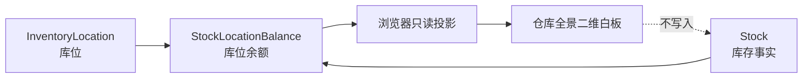

# MES-lite 库存数字孪生仓库 MVP

版本：v0.1.444
日期：2026-08-28

## 目标

在“库存 → 仓库全景”提供一个可直接试用的二维仓库白板，让管理人员快速回答三个问题：有哪些授权库位、每个库位放了什么、哪些库位存在待检/冻结/返工风险。

## 已交付范围

- 使用独立只读查询投影现有库存和库位，不新增数据库表、不复制库存余额。
- 只展示当前账号 `stocks.read` 和库位数据范围允许看到的事实。
- 库位卡片按 `可用 / 待检 / 冻结 / 返工 / 空库位` 着色。
- 输入物料编码、名称、规格或库位并按回车/点击搜索，匹配库位高亮。
- 支持鼠标拖动白板、放大、缩小和复位。
- 点击库位查看每种物料的原单位总量、可用量、待检量、冻结量和返工量，并可返回库存管理。

## 数据关系

不同物料、不同单位永远逐行显示，不把 `kg`、`m`、`件` 相加成无意义的仓库总数。库位风险色按 `冻结 > 待检 > 返工 > 可用 > 空` 的优先级呈现。

当系统检测到库存完整性问题时，仓库全景仍按库位余额生成只读诊断视图，并显示黄色警告；这不会放开库存过账，通用库存页和写入流程仍保持原有完整性门禁。

## v0.1.499 仓库货物身份与空间模型准备（实施候选）

仓库独立装箱、标签和选箱发货先建立明确的货物身份：复用 `PackageDocument` 及其真实批次明细，容器只记录包装类型；`GoodsPlacement` 对每箱唯一关联正式库位，可空 XYZ 坐标表示尚未测量，不能当作已精确定位。

空间模型采用 `Warehouse → WarehouseLayoutVersion → WarehouseSpatialNode`，节点用相对父节点整数毫米 XYZ、长宽高、朝向连接楼层、区域、货架、层及现有 `InventoryLocation`；不复制库存余额。货物移动历史与原移库事务保留关联，空间展示未来与同一货物身份接通。

本期不提供 3D、永久布局编辑/发布、货物拖动过账、设备实时坐标、温湿度或自动刷新，现有白板拖动仍仅移动视图。标签/选箱与空间基础的精确实现和验收见[仓库装箱方案](../plans/仓库装箱与标签发货.md)及正式发布记录；模型准备不表示三维功能已交付。任何实际库存变化必须调用既有库存事务与冲销流程。
